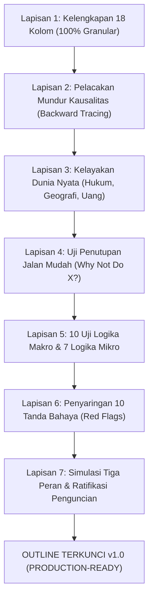

# 03: Struktur, Kerangka Plot, dan Outline

> **Acuan Utama:** `../Kerangka Plot yang Terbukti untuk Web Novel.md`.
> **Prinsip Pas:** subplot, flashback, dan scene ikonik bersifat opsional (boleh nol). Angka yang disebut adalah batas atas, bukan target.

## 1. Format & Alokasi Bab

- **Panjang:** **30–40 bab**, target ±750 kata/bab (rentang wajib 600–900 kata; bab titik balik target 900 kata).
- **Satu bab** hanya memuat satu kejadian utama (satu adegan/beat), satu POV, dan wajib diakhiri *hook*.
- **Hitungan Bahan & Alokasi:**

| Panjang Novel | Titik Balik Minimal | Siklus Coba-Gagal (Babak 2) | Pembagian Tiga Babak | Arc Bersarang |
|---|---:|---|---|---|
| **30 bab** (±22.500 kata) | **6 titik balik** | 3–5 siklus | 8 / 15 / 7 | 3 arc × 10 bab |
| **40 bab** (±30.000 kata) | **8 titik balik** | 3–6 siklus | 10 / 20 / 10 | 4 arc × 10 bab |

### Posisi Titik Penting

| Titik Struktur | Posisi (%) | 30 Bab | 40 Bab | Fungsi Utama |
|---|---:|---|---|---|
| **Pemicu masalah** | 10% | Bab 3 | Bab 4 | Masalah mendadak mengunci tokoh (Bab 1 sudah *in medias res*). |
| **Masuk Babak 2 (Keputusan)** | 20–25% | Bab 6–7 | Bab 8–10 | Tokoh mengambil keputusan aktif masuk ke masalah. |
| **Titik tengah (Midpoint)** | 50% | Bab 15 | Bab 20 | Kemenangan semu, kekalahan semu, atau fakta baru yang mengubah arah. |
| **Titik terendah (Semua hilang)** | 75% | Bab 22–23 | Bab 30 | Rencana runtuh, tokoh menyerah sejenak sebelum menemukan benih solusi. |
| **Solusi dari benih (Planting)** | 80–90% | Bab 25–27 | Bab 32–36 | Tokoh menyadari/merakit solusi dari bahan yang sudah ditanam di Babak 1–2. |
| **Puncak (Klimaks)** | 90–95% | Bab 28–29 | Bab 37–38 | Konfrontasi/tindakan penentu dengan cara khas tokoh & harga nyata. |
| **Penutup (Resolusi)** | 100% | Bab 30 | Bab 40 | Akhir tidak sempurna (ada harga yang dibayar) dan bukti perubahan tokoh. |

**Cara menghitung titik balik:** Titik balik adalah kejadian yang mengubah arah masalah atau menutup satu pilihan tokoh (1 pemicu + 1 keputusan masuk + 1 per siklus percobaan + 1 titik tengah + 1 titik terendah + 1 solusi + 1 puncak). Jika jumlahnya kurang dari minimal tabel di atas, tambah siklus atau lapisan masalah.

---

## 2. Delapan Kerangka Plot yang Terbukti

Gunakan 8 kerangka plot terbukti ini sebagai fondasi dan kompas inspirasi. Penulis dan AI bebas bereksperimen menggabungkan atau memodifikasi pola (struktur hibrida & bentuk naratif khusus) dengan mengambil inspirasi dari karya-karya teruji, asalkan tetap lolos Uji 5 Slot Kelayakan Premis dan 10 Uji Logika Alur Cerita:

### Kerangka 1–4: Fondasi
1. **Struktur Tiga Babak (Freytag, Syd Field):**
   - *Langkah:* Babak 1 (latar, pemicu, keputusan masuk), Babak 2 (usaha makin sulit, titik tengah, titik terendah), Babak 3 (puncak, penyelesaian).
   - *Porsi 40 bab:* 25% / 50% / 25% (Bab 1–10, 11–30, 31–40).
   - *Syarat lolos:* Punya pemicu di Bab 1–5, titik tengah yang mengubah arah, dan titik terendah sebelum solusi.
2. **Save the Cat (Blake Snyder / Jessica Brody):**
   - *15 Beat (40 bab):* Gambar pembuka (Bab 1), Tema (Bab 2), Pemicu (Bab 4), Debat (Bab 5–8), Masuk Babak 2 (Bab 8), Senang-senang & gagal (Bab 9–19), Titik tengah kemenangan/kekalahan semu (Bab 20), Tekanan makin dekat (Bab 21–29), Semua hilang (Bab 30), Malam gelap (Bab 31), Masuk Babak 3 (Bab 32), Puncak (Bab 33–39), Gambar penutup (Bab 40).
   - *Syarat lolos:* Tokoh punya kekurangan jelas di Bab 1 yang diperbaiki di akhir, dan "semua hilang" bukan kebetulan.
3. **Story Circle (Dan Harmon):**
   - *8 Langkah:* (1) Zona nyaman, (2) Menginginkan sesuatu, (3) Masuk situasi baru, (4) Mencari & beradaptasi/percobaan, (5) Mendapat yang diinginkan, (6) Membayar harganya, (7) Kembali, (8) Berubah.
   - *Cocok untuk:* Pencarian jati diri dan *quarter-life crisis*.
   - *Syarat lolos:* Keinginan (*want*) dan kebutuhan (*need*) berbeda, serta ada harga nyata di langkah 6.
4. **Seven-Point Structure (Dan Wells):**
   - *7 Titik (disusun dari akhir ke awal):* Hook, Titik balik 1, Tekanan 1, Titik tengah, Tekanan 2, Titik balik 2, Resolusi.
   - *Kekuatan:* Keadaan awal (*hook*) dan akhir (*resolusi*) berkebalikan. Terbaik untuk logika ketat dan menanam benih solusi (*planting*) karena resolusi ditetapkan lebih dulu.

### Kerangka 5–8: Sesuai Jenis Cerita
5. **Fichtean Curve (John Gardner):**
   - *Langkah:* Pengantar singkat, Krisis 1, Krisis 2, Krisis 3 dst., Puncak, Penutup pendek.
   - *Cocok untuk:* Cerita kesalahan yang menyebar beruntun.
   - *Syarat lolos:* Tiap krisis lebih besar dari sebelumnya dan lahir langsung dari solusi krisis sebelumnya (beri jeda komedi/napas agar pembaca tidak *burnout*).
6. **Struktur Romance (Gwen Hayes, *Romancing the Beat*):**
   - *Langkah:* Pengenalan, Pertemuan (*Meet Cute*), Penolakan, Kedekatan, Titik tengah, Mundur, Momen gelap (*Break Up*), Perbaikan (*Grand Gesture*), Akhir.
   - *Kontrak genre:* Wajib berakhir bahagia (HEA) atau "bahagia untuk sekarang" (HFN). Jika pasangan tidak bersatu di akhir, jangan pakai sebagai kerangka utama (jadikan subplot).
   - *Syarat lolos:* Ada alasan kuat kenapa mereka tidak bisa langsung bersatu dan alasan itu bisa diselesaikan.
7. **Kishōtenketsu (Tradisi Asia Timur):**
   - *4 Bagian:* *Ki* (pengenalan), *Shō* (perkembangan), *Ten* (belokan tak terduga tapi sudah ditanam), *Ketsu* (penyatuan dan penerimaan).
   - *Cocok untuk:* Cerita ringan, komunitas, penerimaan diri, tanpa antagonis.
   - *Syarat lolos:* Belokan (*Ten*) harus mengubah makna dua bagian pertama.
8. **Arc Bersarang (Struktur Serial):**
   - *Langkah (40 bab):* 4 arc × 10 bab (atau 3 arc × 10 bab untuk 30 bab). Tiap arc punya awal, krisis, dan penutup sebagian.
   - *Syarat lolos:* Kemenangan atau kerugian sebagian di akhir Arc 1 melahirkan masalah utama Arc 2.

---

## 3. Pemetaan Kerangka ke Format Dasar Penulis (8 Tahap)

Format dasar penulis memiliki 8 tahap: **(1) Latar tokoh, (2) Masalah mendadak, (3) Dilema, (4) Percobaan solusi, (5) Menyerah, (6) Solusi dari benih, (7) Akhir tidak sempurna, dan (8) Perubahan.**

| Kerangka | Latar, Masalah, Dilema | Percobaan Solusi (Siklus Coba-Gagal) | Menyerah & Solusi dari Benih | Akhir & Perubahan |
|---|---|---|---|---|
| **Tiga Babak** | Babak 1 | Babak 2 (titik tengah di tengah) | Titik terendah akhir Babak 2, puncak di Babak 3 | Penyelesaian Babak 3 |
| **Save the Cat** | Gambar pembuka s.d. debat | Senang-senang, titik tengah, tekanan makin dekat | Semua hilang, malam gelap, puncak | Gambar penutup |
| **Story Circle** | Langkah 1–3 | Langkah 4 (mencari dan beradaptasi) | Langkah 5–6 (mendapat, membayar harga) | Langkah 7–8 |
| **Seven-Point** | Hook, titik balik 1 | Tekanan 1, titik tengah, tekanan 2 | Titik balik 2 | Resolusi |
| **Fichtean Curve** | Pengantar, krisis 1 | Krisis 2 sampai *n* | Puncak | Penutup pendek |
| **Struktur Romance** | Pengenalan, pertemuan | Penolakan, kedekatan, titik tengah | Mundur, momen gelap | Perbaikan, akhir |
| **Kishōtenketsu** | *Ki* (pengenalan) | *Shō* (perkembangan) | *Ten* (belokan dari benih yang ditanam) | *Ketsu* (penyatuan & penerimaan) |
| **Arc Bersarang** | Arc 1 | Arc 2–3 | Arc 4 awal | Arc 4 akhir |

---

## 4. Mesin Bagian Tengah: Siklus Coba-Gagal (*Try-Fail Cycles*)

Bagian tengah semua kerangka di atas digerakkan oleh **Siklus Coba-Gagal**. Satu siklus memakan **3–7 bab** (siklus kecil 3–4 bab, siklus besar 5–7 bab dengan subplot). Untuk novel 30–40 bab, susun **3–6 siklus**.

### Enam Isi Wajib Tiap Siklus Coba-Gagal
1. **Tujuan:** Apa yang tokoh coba capai (harus terkait masalah inti dan lolos **Uji 100%**: jika berhasil penuh, masalah inti memang selesai).
2. **Alasan memilih:** Kenapa cara ini masuk akal bagi tokoh pada saat itu.
3. **Cara:** Tindakan nyata yang dilakukan tokoh dalam adegan yang bisa dibayangkan.
4. **Hambatan:** Berasal dari watak tokoh, aturan dunia cerita, atau kelemahan di dalam cara itu sendiri (bukan karena penulis butuh gagal).
5. **Hasil (pilih 1 dari 4):**
   - Gagal dan memperburuk keadaan;
   - Berhasil tapi ada harga mahal;
   - Berhasil sebagian;
   - Hampir berhasil lalu terhenti di detik akhir.
   *(Hasil "berhasil penuh" hanya boleh terjadi di puncak/klimaks).*
6. **Akibat:** Masalah baru yang lahir dari hasil tersebut, ditambah **satu adegan lucu atau canggung (*awkward*)**.

**Urutan siklus yang aman:** Siklus pertama paling sederhana dan jelas gagal -> siklus tengah tampak berhasil -> siklus terakhir sebelum menyerah hampir berhasil lalu runtuh. Setiap siklus wajib menaikkan taruhan atau menyempitkan pilihan tokoh.

---

## 5. Prosedur Menanam Solusi (*Planting* 2 Kali)

Tentukan solusi akhir lebih dulu sebelum mengunci outline, pecah menjadi bahan-bahan pembentuknya, lalu **tanam tiap bahan minimal dua kali sebelum titik terendah**:
1. **Tanaman pertama:** muncul sebagai hal sepele di adegan biasa.
2. **Tanaman kedua:** muncul sebagai hal yang tampak tidak penting/hiasan komedi tetapi sedikit menonjol.

| Jenis Bahan Solusi | Cara Menanam di Babak 1–2 | Contoh dari Novel Teruji |
|---|---|---|
| **Orang** | Muncul di adegan biasa dengan satu kebiasaan khas | Narapidana di pemakaman bab 1 (*Great Expectations*); Gene sebagai kolega sejak awal (*The Rosie Project*) |
| **Benda** | Disebut sambil lalu, lalu dipakai untuk urusan lain dulu | Kikir yang dibawa Pip (*Great Expectations*); cermin yang dijelaskan Dumbledore (*Harry Potter*) |
| **Kebiasaan** | Diulang di dua adegan berbeda sebagai ciri karakter | Jam Passepartout yang tidak pernah disesuaikan (*Around the World in 80 Days*) |
| **Informasi / Kejadian Kecil** | Terucap atau terjadi di adegan sepele / salah tafsir | Cerita Wickham tentang Darcy (*Pride and Prejudice*); suara tawa aneh di loteng (*Jane Eyre*) |

**Larangan keras:** Hindari orang baru yang muncul tepat saat solusi, benda penyelamat yang tidak pernah disebut, atau informasi yang hanya diketahui tokoh sendiri tanpa pernah ditunjukkan ke pembaca.

---

## 6. Referensi Pola dari Studi Kasus Novel Terkenal

Saat merancang struktur dari premis, rujuk pola teruji di `../Kerangka Plot yang Terbukti untuk Web Novel.md`:

| Novel Acuan | Kerangka Utama | Pola Struktur yang Dipakai |
|---|---|---|
| *Around the World in 80 Days* | Fichtean Curve | Tenggat luar ketat; solusi dari fakta dunia (zona waktu) yang sudah ditanam |
| *A Christmas Carol* | Story Circle | Perubahan karakter lewat bukti nyata yang dilihat mata sendiri, bukan ceramah |
| *Laskar Pelangi* | Kishōtenketsu / Episodik | Tenggat di bab 1, tema berulang, akhir tidak sempurna (ada harga nyata) |
| *Pride and Prejudice* | Struktur Romance | Salah paham dari sumber yang tampak masuk akal, dibongkar lewat bukti/tindakan nyata |
| *Emma* | Tiga Babak | Kelemahan tokoh (merasa paling tahu) menjadi mesin penghasil masalah |
| *Jane Eyre* | Tiga Babak | Rahasia besar disebar sebagai gejala-gejala kecil yang dijelaskan keliru |
| *Great Expectations* | Story Circle | Twist utama ditanam di adegan pembuka Bab 1; asumsi salah tokoh menipu pembaca |
| *Bridget Jones's Diary* | Struktur Romance | Kerangka klasik dipindah ke kehidupan lajang urban modern |
| *The Devil Wears Prada* | Story Circle | Dua keinginan bertabrakan; akhir tidak sempurna dengan harga karier yang nyata |
| *The Rosie Project* | Story Circle | Dua proyek paralel; proyek sampingan justru yang mengubah tokoh kaku |
| *Eleanor Oliphant* | Story Circle | Narator tak sepenuhnya andal tapi petunjuk adil sejak awal; perubahan lewat tindakan kecil |
| *Perahu Kertas* | Romance + Story Circle | Dua tokoh saling mencerminkan; jalur impian dan jalur hubungan berjalan paralel |
| *The Hundred-Year-Old Man* | Rantai Domino | Dua garis waktu; komedi dari reaksi tenang tokoh terhadap kekacauan |
| *Harry Potter 1* | Misteri | *Red herring* bermotif nyata; solusi memakai aturan yang sudah diajarkan ke pembaca |
| *The Curious Incident...* | Misteri Keseharian | Penyelidikan kecil di lingkungan rumah membuka rahasia keluarga yang besar |
| *Critical Eleven* | Struktur Romance | Dibuka di tengah krisis; sudut pandang bergantian tanpa perlu tokoh jahat |

---

## 6B. Eksperimentasi Naratif & Bentuk Khusus (Informed Experimentation)

Penulis dan AI tidak dibatasi oleh kerangka kaku. Eksperimen plot yang terinspirasi dari karya teruji sangat dianjurkan melalui teknik berikut:

1. **Bentuk Buku Harian / Diary (*Bridget Jones's Diary*, *Marmut Merah Jambu*):**
   - Format catatan harian menjaga tempo komedi alami dan membuat perkembangan emosi tokoh terlihat jelas dari entri ke entri.
2. **Dua Garis Waktu Paralel (*The Hundred-Year-Old Man*, *Critical Eleven*, *The Time Traveler's Wife*):**
   - Garis waktu masa lalu (bagaimana mereka bertemu atau asal luka batin) berjalan bergantian dengan garis waktu krisis masa kini, dan keduanya menyatu di titik balik penting tanpa membebani cerita dengan tokoh baru.
3. **Sudut Pandang Bergantian / Dual POV (*Critical Eleven*, *One Day*, *The Hating Game*):**
   - Bergantian antara Tokoh A dan Tokoh B untuk memperlihatkan dua sisi prasangka/konflik secara manusiawi tanpa butuh tokoh penjahat karikatur.
4. **Bentuk Epistolari / Pesan / Surat (*Daddy-Long-Legs*, *The Perks of Being a Wallflower*, *Flowers for Algernon*):**
   - Menghadirkan keintiman monolog batin yang kuat lewat pesan chat atau surat.
5. **Dua Proyek Paralel (*The Rosie Project*):**
   - Tokoh menjalankan proyek formal di permukaan (pekerjaan / target kaku), sementara proyek sampingan yang tidak ia rencanakan justru yang meruntuhkan keegoisannya dan mengubah karakternya.
6. **Hibridisasi Kerangka (Struktur Campuran):**
   - Bebas memadukan dua kerangka yang saling melengkapi (misal: *Struktur Romance* untuk garis cinta + *Fichtean Curve* untuk eskalasi krisis kantor; atau *Story Circle* untuk transformasi diri + *Seven-Point Structure* untuk penyelidikan rahasia).

*Syarat Eksperimen Sah:* Tetap berjangkar pada kausalitas logis, lolos Uji 5 Slot Kelayakan Premis, dan memenuhi 10 Uji Logika Alur Cerita.

---

## 7. Prosedur 6 Tahap Pembuatan Outline yang Rapi (SOP Desain Outline)

Pembuatan outline novel MetroPop wajib mengikuti alur 6 tahap berurutan berikut agar arsitektur cerita terkunci kokoh sebelum masuk penulisan prosa:

### Tahap 1: Pemilihan Kerangka Plot & Skala Bab
1. Pilih **Kerangka Utama** dari 8 kerangka terbukti menggunakan Tabel Keputusan di `engine/02-premise.md`.
2. Tentukan target panjang: **30 bab** (±22.500 kata, min 6 titik balik) atau **40 bab** (±30.000 kata, min 8 titik balik).
3. Tentukan tipe pembuka: **Tipe 1 (Direct Action Linier)** atau **Tipe 2 (Flash-Forward Hook Framing)**. Jika memilih Tipe 2, tentukan sejak awal di bab mana adegan *Loop Closure* akan disatukan kembali di titik tengah.

### Tahap 2: Kunci Resolusi & Pelacakan Jejak Mundur (*Backward Dependency Tracing*)
1. Jangan merancang Bab 1 sebelum Babak 3 (Puncak dan Resolusi) jelas. Tentukan adegan klimaks: apa syarat kemenangan tokoh (bukti dokumen, saksi, barang fisik, uang pelunasan).
2. Lakukan pelacakan mundur (*backward tracing*):
   - Syarat kemenangan didapat di bab berapa?
   - Siapa yang memberikan petunjuk awal itu di Babak 2?
   - Benda/informasi tersebut pertama kali diperkenalkan di Babak 1 pada bab berapa?
   Jika satu syarat klimaks tidak memiliki akar fisik di Babak 1-2, outline ditolak.

### Tahap 3: Perancangan Siklus Coba-Gagal (*Try-Fail Cycles*) Babak 2
1. Petakan **3-6 siklus coba-gagal** untuk menggerakkan bagian tengah (Babak 2).
2. Setiap siklus wajib memiliki **6 komponen wajib** (Tujuan, Alasan & Cara, Hambatan, Hasil, Akibat, dan Momen Canggung).
3. Pastikan setiap tujuan siklus lolos **Uji 100%** (jika berhasil penuh, masalah inti memang selesai; jika tidak selesai, itu hanya *filler* dan wajib diganti).
4. Pastikan pola hasil adegan bervariasi (`Berhasil, tapi...` atau `Gagal, dan malah...`).

### Tahap 4: Desain Benih Solusi (*Planting Solusi 2 Kali*)
1. Daftarkan elemen kunci solusi (orang, benda, kebiasaan, informasi).
2. Tanam **Tanaman 1 (Sepele)** di Babak 1 (Bab 1-5).
3. Tanam **Tanaman 2 (Hiasan/Komedi)** di Babak 2 Awal (Bab 6-15) sebelum titik terendah.
4. Pastikan tidak ada solusi akhir yang muncul tiba-tiba (*anti-deus ex machina*).

### Tahap 5: Pengisian 18 Kolom Wajib per Bab secara Granular
1. Isi rincian setiap bab dari Bab 1 sampai Bab akhir tanpa kecuali.
2. Dilarang membuat bab yang hanya berupa ringkasan 1-2 kalimat. Setiap bab wajib memiliki 18 kolom lengkap (waktu, lokasi, POV, ketegangan, beat aksi, siapa tahu apa, hook, jalan keluar tertutup).

### Tahap 6: Eksekusi Gerbang Verifikasi Kesiapan Naskah (*Production-Ready Gate*)
1. Uji outline menggunakan **7 Lapisan Uji Kelayakan Outline** (lihat Bagian 10).
2. Tutup semua lubang logika dan red flags yang terdeteksi.
3. Presentasikan ke user, dapatkan persetujuan, dan tandai outline **TERKUNCI v1.0**.

---

## 8. Standar 18 Kolom Wajib Outline per Bab (Granularitas Produksi)

Outline per bab harus cukup detail dan mandiri sebagai acuan menulis, sehingga saat menulis Bab 1 hingga bab akhir, AI/penulis tidak perlu lagi menebak atau mengarang fakta baru. Semua 18 kolom wajib terisi:

```markdown
### Bab N: Judul (2-5 kata)
- **Hari/jam/lokasi:** Hari [X], [Nama Hari], [Jam persis], [Lokasi spesifik].
- **POV:** Orang Pertama Murni ("Aku" / [Nama Tokoh]).
- **Posisi Kerangka & Siklus:** [Babak & Beat Kerangka Utama] | [Siklus Coba-Gagal X: Komponen].
- **Skor Ketegangan (1-10) & Pergeseran Emosi:** Ketegangan [X]/10; Masuk: [Emosi Awal] -> Keluar: [Emosi Akhir].
- **Tujuan adegan:** Apa target fisik konkret tokoh di bab ini.
- **Komplikasi:** Hambatan tak terduga yang merusak rencana tokoh.
- **Beat adegan:** 1) ... 2) ... 3) ... 4) ...
- **Perubahan (`Berhasil, tapi...` / `Gagal, dan malah...`):** Hasil akhir adegan dan buntut masalah barunya.
- **Siapa tahu apa (Asimetri Pengetahuan):** Siapa menyaksikan, data mikro baru yang diperoleh sah, siapa belum tahu.
- **Setup/Planting yang ditanam:** Detail benda/info/kebiasaan yang ditanam (tandai Tanaman 1 atau 2 jika bagian solusi akhir).
- **Payoff yang dibayar:** Benih masa lalu yang dipanen/dibuktikan di bab ini.
- **Teknik naratif:** (1-2 teknik: in medias res, dramatic irony, action beats, pacing naik-turun).
- **Hook kalimat terakhir:** Pertanyaan/ketegangan menggantung yang memancing pembaca membuka bab berikutnya.
- **Kenapa masuk akal:** Satu kalimat bukti rantai logika kausalitas.
- **Jalan keluar paling mudah ditutup:** Alasan fisik/hukum/sosial konkret kenapa jalan pintas gampang tidak bisa diambil.
- **Pertanyaan pembaca yang dijawab:** Penjelasan misteri/informasi yang dibuka untuk pembaca.
- **Yang TIDAK terjadi:** Batasan tegas peristiwa yang dilarang terjadi di bab ini (mencegah eskalasi terlalu cepat).
- **Target kata:** Standar ±750 kata (titik balik ±900 kata; maksimal 900 kata; darurat maks. 1.200 kata).
```

*Kolom opsional (isi hanya jika lolos Tes Pas):* `Subplot/flashback`, `Jenis adegan`, `Ikonik`.

---

## 9. Subplot, Flashback, Scene Ikonik, dan Ketentuan In Medias Res

- **Subplot (Opsional, 0-3):** Plot utama (A) 60-100%, Romansa (B) ≤25%, Keluarga/sosial (C) ≤20%. Jangan membuka subplot baru setelah titik tengah kecuali sudah ditanam di Babak 1.
- **Flashback (Opsional):** Dipicu benda/kata/tempat konkret, beri penanda waktu jelas, kembali ke masa kini dengan perubahan pemahaman, dicatat di Ledger A2.
- **Scene Ikonik (Opsional, 0-5):** Mudah diceritakan ulang dalam satu kalimat, berakar pada karakter dan tema, wajib punya setup.
- **Teknik Naratif (1-2 per bab):**
  - *Wajib:* In medias res (Bab 1: pilih **Tipe 1 Direct Action** linier atau **Tipe 2 Flash-Forward Hook Framing**; lihat `06-chapter.md`), Hook akhir bab, Chekhov's gun / Planting 2x.
  - *Sering:* Show don't tell, Action beats, Dramatic irony, Pacing naik-turun.
  - *Sesekali:* Foreshadowing, Motif, Stream of consciousness (maks 1 paragraf saat panik), Red herring adil, Plot twist fair play, Allusion budaya Indonesia.
  - *Dilarang:* Deus ex machina (kebetulan boleh memperburuk keadaan, dilarang menyelamatkan tokoh).

### Ketentuan Outline untuk Pembuka Tipe 2 (Flash-Forward Hook Framing)
Jika outline menggunakan **Tipe 2**, perhatikan penandaan khusus pada kolom outline:
1. **Bab 1 & 2:** Tandai kolom posisi dengan `[Flash-Forward: Puncak Krisis / Anomali]` (mengambil momen genting dari Midpoint atau Titik Rendah).
2. **Bab 3:** Tandai dengan `[Rewind: X Waktu Sebelumnya]` dan **wajib dibuka dengan In Medias Res Tipe 1** pada garis waktu awal (tanpa bangun tidur/eksposisi).
3. **Bab Midpoint/Krisis (misal Bab 15-16 atau Bab 19-20):** Tandai dengan `[Loop Closure: Revisit Adegan Pembuka]`. Di sini alur waktu lampau bertemu kembali dengan Bab 1-2, ditulis dengan subteks, perspektif, dan muatan emosi yang sudah matang (bukan salin-tempel).

---

## 10. Gerbang Verifikasi Kesiapan Naskah: 7 Lapisan Uji Kelayakan Outline (*Outline Production-Ready Gate*)

Sebelum outline diserahkan kepada user untuk disetujui dan dikunci (**TERKUNCI v1.0**), outline **WAJIB lolos 7 Lapisan Uji Kelayakan** berikut. Jika ada satu lapisan yang gagal, outline **BELUM BOLEH DIGUNAKAN UNTUK MENULIS**:



### Lapisan 1: Kelengkapan Kolom & Kepadatan Bahan (100% Granular)
- [ ] Seluruh bab (Bab 1 s.d. 30/40) memiliki **18 kolom wajib terisi lengkap tanpa tanda tanya `?` atau `TBD`**.
- [ ] Jumlah titik balik memenuhi syarat minimal (≥6 titik balik untuk 30 bab, ≥8 titik balik untuk 40 bab).
- [ ] Bab 1 terdefinisi jelas tipe pembukanya (Tipe 1 Direct Action Linier atau Tipe 2 Flash-Forward dengan titik Loop Closure terjadwal).

### Lapisan 2: Pelacakan Mundur Kausalitas (*Backward Dependency Tracing*)
- [ ] Seluruh aset kemenangan di klimaks Babak 3 (bukti fisik, saksi, dokumen, uang pelunasan) memiliki jejak perolehan sah di Babak 2 dan benih awal di Babak 1.
- [ ] Tidak ada tokoh penyelamat, bukti ajaib, atau kebetulan penyelamat yang muncul tiba-tiba di Babak 3.

### Lapisan 3: Kelayakan Dunia Nyata & World Building (*World Building Stress-Test*)
- [ ] Prosedur hukum Indonesia nyata (SOP Laporan Polisi resmi, UU ITE, rahasia perbankan mutlak tanpa retasan akun pribadi ajaib oleh tim IT swasta).
- [ ] Realitas transportasi & jam sibuk (jarak tempuh, jam macet 07.00-09.30 dan 16.30-19.30, SOP parkir gedung).
- [ ] Konsistensi hitungan uang (pembagian DP, sisa pelunasan, pembayaran utang, dan saldo riil).

### Lapisan 4: Penutupan Jalan Paling Mudah (*Adversarial 'Why Not Do X?' Test*)
- [ ] Pada setiap bab krisis, alasan mengapa tokoh tidak memilih jalan termudah (jujur langsung, lapor bos, lapor keluarga) diuji secara kritis.
- [ ] Alasan penutupan jalan mudah **wajib berupa fakta fisik, hukum tertulis, atau ancaman nyata**, bukan sekadar rasa gengsi atau sungkan tanpa risiko.

### Lapisan 5: 10 Uji Logika Alur Cerita & 7 Logika Mikro
- [ ] Memenuhi 10 Uji Logika Makro (`engine/08-quality.md` Bagian 2): Konsekuensi Nyata, Tenggat Luar, Jalan Pintas Tertutup, Uji 100%, Taruhan Naik, Keputusan Aktif Tokoh, Planting 2 Kali, Harga Sebanding, Kalender & Matriks Pengetahuan, Budaya Indonesia.
- [ ] Memenuhi 7 Uji Logika Mikro (`engine/08-quality.md` Bagian 2B): Anti-Redundansi Dialog, Prosedur Nyata Indonesia, Matematika Uang Konsisten, Logika Fisik Dimensi Benda/Wadah, Jalur Informasi Eksplisit, Motivasi Antagonis Logis, Realitas Iklim Lokal.

### Lapisan 6: Penyaringan 10 Tanda Bahaya (*Red Flags Filter*)
- [ ] Bersih dari 10 Tanda Bahaya (`engine/08-quality.md` Bagian 3): Masalah tidak bisa selesai hanya dengan 1 obrolan jujur; tokoh tidak dipaksa bertindak bodoh demi alur; siklus coba-gagal tidak monoton; akhir cerita memiliki harga nyata yang dibayar.

### Lapisan 7: Simulasi Tiga Peran & Ratifikasi Penguncian (*Outline Lock*)
- [ ] Lolos simulasi 3 peran (`engine/08-quality.md` Bagian 4): Pembaca Awam Curiga, Antagonis Cerdas, dan Protagonis Logis.
- [ ] Ringkasan outline dan lubang logika yang sudah ditutup dipresentasikan kepada user.
- [ ] User menyetujui, dan status outline diubah menjadi **TERKUNCI v1.0**.

---

## 11. Penguncian Outline (TERKUNCI v1.0), Garansi Anti-Ubah Bab 1, & Protokol Krisis

### Garansi Anti-Ubah Mulai dari Bab 1
Setelah outline lolos 7 Lapisan Uji Kelayakan dan diberi label **TERKUNCI v1.0**, sistem memberikan garansi stabilitas alur:
1. **Penulisan Bab 1 Berjalan Tanpa Ragu:** Penulis/AI menulis Bab 1 langsung dari spesifikasi kolom yang terkunci. Tidak ada lagi kebingungan arah cerita atau revisi struktural di awal.
2. **Karantina Ide Spontan:** Ide-ide baru, dialog lucu tambahan, atau sentuhan minor yang muncul saat menulis prosa bab ditampung di `idea-list.md` tanpa mengubah arsitektur outline terkunci.
3. **Protokol Perubahan Formal:** Outline yang sudah terkunci **DILARANG diubah diam-diam**. Perubahan alur hanya boleh dilakukan jika user secara eksplisit meminta perubahan melalui formulir `engine/templates/change-request.md`.

### Mitigasi Krisis Logika Tengah Cerita (*In-Flight Crisis Mitigation*)
Jika di tengah penulisan bab (misalnya saat menulis Bab 20) tiba-tiba ditemukan jalan buntu atau fakta baru yang membuat rencana semula terasa mustahil:
- **DILARANG MEROMBAK NASKAH DARI AWAL:** Jangan pernah menghapus Bab 1 sampai Bab 19!
- **Terapkan Karantina Radius Ledakan (*Blast Radius Containment*):** Kunci bab-bab steril yang sudah ditulis (Bab 1 s.d. N-k dilarang diubah).
- **Gunakan 4 Teknik Bedah Alur (`engine/08-quality.md` Bagian 4B & `engine/12-audit-remediation.md`):**
  1. *Pengalihan Rute Kausal:* Manfaatkan aset/tokoh/benda yang sudah ada di bab sebelumnya sebagai jembatan alternatif.
  2. *Memeluk Kemustahilan Menjadi Komplikasi:* Jadikan kegagalan rencana tersebut sebagai kepanikan nyata tokoh di bab berjalan.
  3. *Jahitan Bedah Mikro:* Lakukan revisi lokal rasio 74/18/8 pada bab terdekat tanpa merembet ke bab-bab awal.
  4. *Pertukaran Beban Pembuktian:* Buat pihak lawan yang membocorkan rahasianya sendiri karena panik atau sombong.
- **Sinkronisasi Maju (*Forward Cascading Sync*):** Sesuaikan hanya sisa bab di outline ke depan (Bab N+1 s.d. selesai) dan mintakan konfirmasi *Change Request* kepada user.

